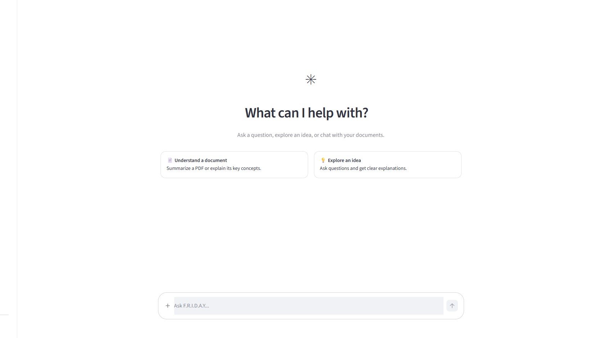

# F.R.I.D.A.Y — Agentic AI Assistant with RAG

<p align="center">
  
</p>

<p align="center">
  An agentic AI assistant built with Python, LangGraph, LangChain, Groq, and Streamlit.
  <br />
  Chat naturally, ask questions about uploaded PDFs, search the web, check weather and stock prices, and perform calculations.
</p>

<p align="center">
  <a href="https://youtu.be/c8cNnl3ZWiA">▶ Watch Demo</a>
</p>

---

## Overview

**F.R.I.D.A.Y** is an agentic AI assistant that combines conversational AI with tool calling and Retrieval-Augmented Generation (RAG).

Instead of relying only on an LLM's internal knowledge, F.R.I.D.A.Y can decide when to use external tools, retrieve information from uploaded PDF documents, and maintain conversation history across sessions.

The application uses **LangGraph** to manage the agent workflow, **Groq** to power the language model, and **Streamlit** to provide an interactive chat interface.

## Features

- **Agentic Conversations:** Interact with an LLM that can decide whether to answer directly or invoke an appropriate tool.
- **PDF-based RAG:** Upload PDF documents and ask questions based on their contents.
- **Semantic Retrieval:** Retrieve relevant document chunks using embeddings and FAISS vector search.
- **Web Search:** Search the web for current events and information using Tavily.
- **Weather Information:** Retrieve current weather conditions for a given location.
- **Stock Price Lookup:** Fetch stock market quotes using Alpha Vantage.
- **Calculator:** Perform mathematical calculations through a dedicated tool.
- **Persistent Chat History:** Save and restore conversations using LangGraph's SQLite checkpointing.
- **Streaming Responses:** Display assistant responses progressively in the Streamlit interface.
- **Chat History Sidebar:** Navigate previous conversations and start new chats.

## Architecture & Workflow

F.R.I.D.A.Y follows a graph-based agent architecture. The LLM acts as the decision-making component, while LangGraph manages tool execution and the conversation flow.

### System Architecture

<p align="center">
  
</p>

### Agent Workflow

1. **User Input:** The user sends a message through the Streamlit chat interface.
2. **Conversation State:** The message is passed to the LangGraph workflow along with the conversation's thread ID.
3. **LLM Decision:** The Groq-powered LLM analyzes the conversation and decides whether it can answer directly or needs a tool.
4. **Tool Execution:** If a tool is required, LangGraph routes execution to the tool node.
5. **Tool Response:** The tool result is returned to the LLM, which processes the result and generates a response.
6. **Final Response:** The assistant's response is streamed to the user.
7. **Persistence:** SQLite checkpointing stores conversation state so previous chats can be restored.

### PDF Ingestion & Retrieval Workflow

The PDF RAG pipeline allows the assistant to answer questions using uploaded documents.

1. The user uploads a PDF through the Streamlit interface.
2. The application temporarily stores the uploaded file.
3. The backend processes the PDF and extracts its text.
4. The extracted content is prepared and converted into vector embeddings.
5. FAISS stores the document vectors for similarity-based retrieval.
6. When the user asks a document-related question, the agent invokes the RAG tool.
7. Relevant document content is retrieved and passed to the LLM.
8. The LLM generates a response grounded in the retrieved context.

## Tools

F.R.I.D.A.Y currently supports the following tools:

| Tool | Purpose | Integration |
|---|---|---|
| `rag_tool` | Retrieve information from uploaded PDFs | FAISS / Embeddings |
| `search_tool` | Search the web for recent information | Tavily |
| `get_current_weather` | Retrieve current weather information | OpenWeatherMap |
| `get_stock_price` | Fetch stock market quotes | Alpha Vantage |
| `calculator` | Perform mathematical calculations | Python |

The agent selects tools based on the user's request. For example, a question about an uploaded PDF triggers document retrieval, while a request for current weather triggers the weather tool.

## Tech Stack

| Category | Technologies |
|---|---|
| Language | Python |
| LLM | Groq — `openai/gpt-oss-120b` |
| Agent Framework | LangGraph |
| LLM Integration | LangChain |
| RAG | Retrieval-Augmented Generation |
| Vector Database | FAISS |
| Embeddings | Google Generative AI Embeddings |
| Web Search | Tavily |
| Weather API | OpenWeatherMap |
| Stock API | Alpha Vantage |
| Database | SQLite |
| Frontend | Streamlit |
| Environment Management | Python dotenv |

## Project Structure

```text
F.R.I.D.A.Y/
│
├── images/
│   └── architecture.png
│
├── DB/
│   └── chat​bot.db
│
├── faiss_db/
│   ├── index.faiss
│   └── index.pkl
│
├── app_rag.py
├── backend.py
├── tools.py
├── requirements.txt
├── .env
├── .gitignore
└── README.md
```

*The structure above illustrates the main application components. Your actual repository may contain additional modules or folders.*

## Getting Started

Follow these steps to run F.R.I.D.A.Y locally.

### 1. Clone the Repository

```bash
git clone <YOUR_REPOSITORY_URL>
cd F.R.I.D.A.Y
```

### 2. Create a Virtual Environment

```bash
python -m venv venv
```

Activate the environment:

**Windows:**

```bash
venv\Scripts\activate
```

**Linux / macOS:**

```bash
source venv/bin/activate
```

### 3. Install Dependencies

```bash
pip install -r requirements.txt
```

### 4. Configure Environment Variables

Create a `.env` file in the project root directory.

```env
# LLM
GROQ_API_KEY=your_groq_api_key

# Embeddings
GOOGLE_API_KEY=your_google_api_key

# Web Search
TAVLIY_API_KEY=your_tavily_api_key

# Weather
OPENWEATHER_API_KEY=your_openweathermap_api_key

# Stock Market
ALPHA_VANTAGE_API_KEY=your_alpha_vantage_api_key
```

**API keys:**

- Groq: https://console.groq.com/
- Google AI Studio: https://aistudio.google.com/
- Tavily: https://tavily.com/
- OpenWeatherMap: https://openweathermap.org/api
- Alpha Vantage: https://www.alphavantage.co/support/#api-key

Only configure the API keys for the tools you intend to use. The Groq key is required for the language model. Google credentials are required for the Google embedding integration.

### 5. Run the Application

```bash
streamlit run app_rag.py
```

Open the local URL displayed in your terminal to access F.R.I.D.A.Y.

## How to Use

### General Conversations

Enter a message in the chat input. F.R.I.D.A.Y can answer general questions directly or use tools when necessary.

### Ask Questions About PDFs

1. Upload a PDF document through the application.
2. Wait for the document processing to complete.
3. Ask questions related to the uploaded document.
4. The agent retrieves relevant content and generates a context-aware answer.

### Use External Tools

You can also ask questions that require external information or calculations.

Examples:

```text
Search for the latest developments in artificial intelligence.

What is the current weather in Dhaka?

What is the latest stock price of AAPL?

Calculate the compound interest on 10000 at 8% for 5 years.

Summarize the main findings from my uploaded PDF.
```

### Manage Conversations

- Click **New Chat** to start a new conversation.
- Select a previous conversation from the sidebar to continue it.
- Conversation state is maintained through SQLite checkpointing.

## Environment & Configuration Notes

- Keep your `.env` file private and never commit API keys to GitHub.
- SQLite checkpoint data is stored locally in the `DB/` directory.
- Uploaded PDF files are temporarily stored for processing and removed afterward by the application.
- FAISS index files are used for document retrieval; their persistence depends on the configured indexing implementation.
- External tools depend on their respective API availability and credentials.

## Future Improvements

- Support multiple PDF documents and more advanced document management.
- Improve retrieval quality with hybrid search and reranking.
- Add source citations and page-level references to PDF answers.
- Introduce authentication and user-specific conversation storage.
- Improve error handling and API rate-limit management.
- Deploy the application with persistent storage.

## Demo

<p align="center">
  <a href="https://youtu.be/c8cNnl3ZWiA">
    
  </a>
  <br />
  <a href="https://youtu.be/c8cNnl3ZWiA">Watch F.R.I.D.A.Y in Action</a>
</p>

## Author

**Md. Iftiar Rafi**

- GitHub: https://github.com/iftiarrafi
- Email: iftiarrafi@gmail.com

---

<p align="center">
  Built with Python, LangGraph, LangChain, and Groq.
</p>